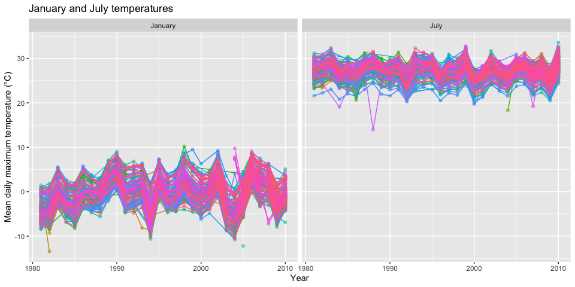
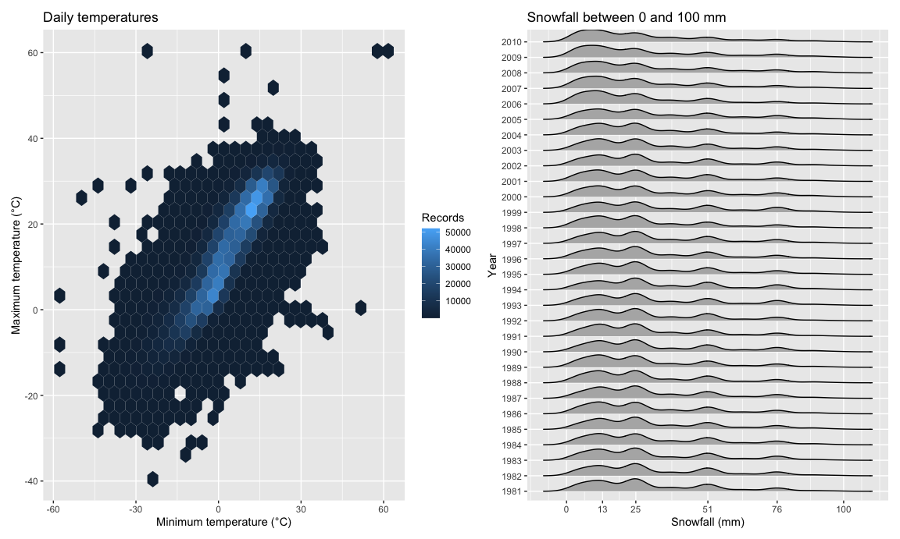
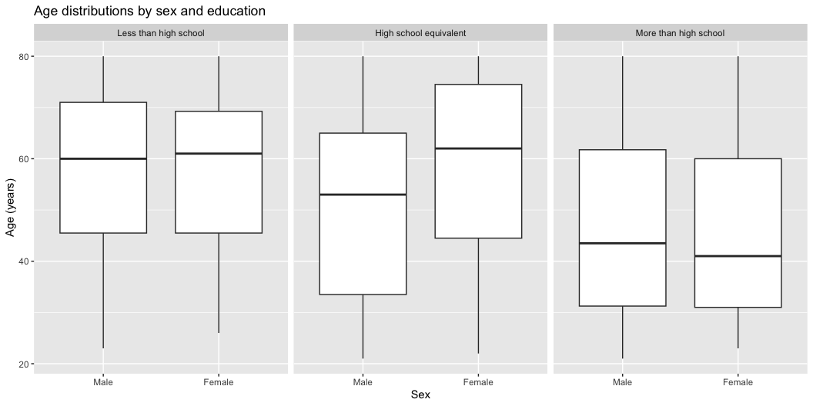
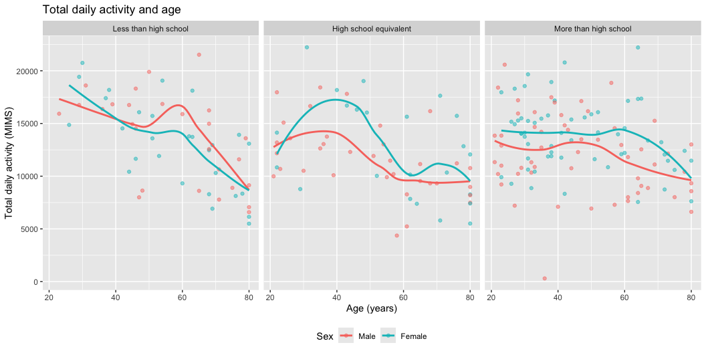

P8105_HW3_zw3268
================
Zeheng Wei
2026-10-14

# Problem 1

### 1. Load and describe the data

``` r
library(tidyverse)
library(p8105.datasets)
library(patchwork)
library(ggridges)

data("ny_noaa")
noaa_df = ny_noaa

skimr::skim(noaa_df)
```

|                                                  |         |
|:-------------------------------------------------|:--------|
| Name                                             | noaa_df |
| Number of rows                                   | 2595176 |
| Number of columns                                | 7       |
| \_\_\_\_\_\_\_\_\_\_\_\_\_\_\_\_\_\_\_\_\_\_\_   |         |
| Column type frequency:                           |         |
| character                                        | 3       |
| Date                                             | 1       |
| numeric                                          | 3       |
| \_\_\_\_\_\_\_\_\_\_\_\_\_\_\_\_\_\_\_\_\_\_\_\_ |         |
| Group variables                                  | None    |

Data summary

**Variable type: character**

| skim_variable | n_missing | complete_rate | min | max | empty | n_unique | whitespace |
|:--------------|----------:|--------------:|----:|----:|------:|---------:|-----------:|
| id            |         0 |          1.00 |  11 |  11 |     0 |      747 |          0 |
| tmax          |   1134358 |          0.56 |   1 |   4 |     0 |      532 |          0 |
| tmin          |   1134420 |          0.56 |   1 |   4 |     0 |      548 |          0 |

**Variable type: Date**

| skim_variable | n_missing | complete_rate | min | max | median | n_unique |
|:---|---:|---:|:---|:---|:---|---:|
| date | 0 | 1 | 1981-01-01 | 2010-12-31 | 1997-01-21 | 10957 |

**Variable type: numeric**

| skim_variable | n_missing | complete_rate |  mean |     sd |  p0 | p25 | p50 | p75 |  p100 | hist  |
|:--------------|----------:|--------------:|------:|-------:|----:|----:|----:|----:|------:|:------|
| prcp          |    145838 |          0.94 | 29.82 |  78.18 |   0 |   0 |   0 |  23 | 22860 | ▇▁▁▁▁ |
| snow          |    381221 |          0.85 |  4.99 |  27.22 | -13 |   0 |   0 |   0 | 10160 | ▇▁▁▁▁ |
| snwd          |    591786 |          0.77 | 37.31 | 113.54 |   0 |   0 |   0 |   0 |  9195 | ▇▁▁▁▁ |

``` r
temp_count =
  noaa_df |>
  filter(!is.na(tmax) | !is.na(tmin)) |>
  summarize(n_stations = n_distinct(id))
```

The dataset contains 2595176 records and 7 variables from 747 weather
stations in New York State, covering 1981-01-01 to 2010-12-31. Each row
is one station’s daily weather record. The variables are station ID,
date, precipitation, snowfall, snow depth, and daily maximum and minimum
temperatures. The data are already tidy, with one variable per column
and one station-day per row. The original temperature units are tenths
of a degree Celsius, and precipitation is in tenths of a millimeter;
snowfall and snow depth are in millimeters.

Station IDs and dates have no missing values. Temperature data have the
most missing values: `tmax` and `tmin` are missing in 43.71% and 43.71%
of records. Only 237 stations have at least one temperature observation.
Precipitation, snowfall, and snow depth are missing in 5.62%, 14.69%,
and 22.8%, respectively. Each analysis will use the available
observations for the variables it needs.

### 2. Clean the dates, variable types, and units

``` r
noaa_df =
  noaa_df |>
  mutate(date_parts = date) |>
  separate(date_parts, into = c("year", "month", "day"), sep = "-") |>
  mutate(
    year = as.numeric(year),
    month = as.numeric(month),
    day = as.numeric(day),
    tmax = as.numeric(tmax) / 10,
    tmin = as.numeric(tmin) / 10,
    prcp = prcp / 10)

head(noaa_df)
```

    ## # A tibble: 6 × 10
    ##   id          date        prcp  snow  snwd  tmax  tmin  year month   day
    ##   <chr>       <date>     <dbl> <int> <int> <dbl> <dbl> <dbl> <dbl> <dbl>
    ## 1 US1NYAB0001 2007-11-01    NA    NA    NA    NA    NA  2007    11     1
    ## 2 US1NYAB0001 2007-11-02    NA    NA    NA    NA    NA  2007    11     2
    ## 3 US1NYAB0001 2007-11-03    NA    NA    NA    NA    NA  2007    11     3
    ## 4 US1NYAB0001 2007-11-04    NA    NA    NA    NA    NA  2007    11     4
    ## 5 US1NYAB0001 2007-11-05    NA    NA    NA    NA    NA  2007    11     5
    ## 6 US1NYAB0001 2007-11-06    NA    NA    NA    NA    NA  2007    11     6

I kept the original date and added separate numeric year, month, and day
variables. The temperature columns were stored as text, so I converted
them to numbers and divided by 10 to get degrees Celsius. I also divided
precipitation by 10 to get millimeters. Snowfall and snow depth are
already in millimeters, so I kept their units. The cleaning keeps all
records and leaves missing values as NA; they will be handled separately
for each analysis.

### 3. Most common snowfall values

``` r
snow_freq =
  noaa_df |>
  drop_na(snow) |>
  count(snow) |>
  arrange(desc(n))

snow_zero =
  snow_freq |>
  filter(snow == 0)

head(snow_freq, 10) |>
  knitr::kable()
```

| snow |       n |
|-----:|--------:|
|    0 | 2008508 |
|   25 |   31022 |
|   13 |   23095 |
|   51 |   18274 |
|   76 |   10173 |
|    8 |    9962 |
|    5 |    9748 |
|   38 |    9197 |
|    3 |    8790 |
|  102 |    6552 |

Zero snowfall is the most common value, appearing in 2008508 records.
The next most common values are 25, 13, 51, and 76 mm. Most days have no
recorded snowfall. These nonzero amounts correspond approximately to 1,
0.5, 2, and 3 inches, respectively. This pattern is consistent with
snowfall recorded in inches and then converted and rounded to
millimeters.

### 4. January and July average maximum temperatures

``` r
month_df =
  noaa_df |>
  filter(month %in% c(1, 7)) |>
  group_by(id, year, month) |>
  summarize(mean_tmax = mean(tmax, na.rm = TRUE)) |>
  drop_na(mean_tmax) |>
  mutate(month = case_match(month, 1 ~ "January", 7 ~ "July"))

month_df |>
  ggplot(aes(x = year, y = mean_tmax, color = id)) +
  geom_point(alpha = .5) +
  geom_line() +
  facet_grid(. ~ month) +
  theme(legend.position = "none") +
  labs(
    title = "January and July temperatures",
    x = "Year",
    y = "Mean daily maximum temperature (°C)")
```

<!-- -->

``` r
jan_low =
  month_df |>
  filter(month == "January") |>
  arrange(mean_tmax) |>
  head(1)

july_low =
  month_df |>
  filter(month == "July") |>
  arrange(mean_tmax) |>
  head(1)

july_check =
  noaa_df |>
  filter(id == july_low$id, year == july_low$year, month == 7) |>
  summarize(
    days = n(),
    inverted = sum(tmax < tmin, na.rm = TRUE))
```

Each point represents one station’s monthly average maximum temperature
in one year, and each line connects the available yearly averages for
that station. July is much warmer than January, while January station
averages generally show more variation. The lowest January point is
station USC00301723 in 1982, with a mean of -13.44°C; a low winter
temperature alone does not establish a data error. An unusually low July
point is station USC00308962 in 1988, with a mean of 13.95°C. Its
recorded maximum temperature is below the minimum temperature on 31 of
31 days, suggesting a data issue. I kept these points rather than
changing the readings. Monthly means use the available temperatures, and
lines can connect observed years across gaps, so coverage differences
should be kept in mind.

### 5. Temperature relationship and snowfall distributions

``` r
temp_plot =
  noaa_df |>
  drop_na(tmax, tmin) |>
  ggplot(aes(x = tmin, y = tmax)) +
  geom_hex() +
  labs(
    title = "Daily temperatures",
    x = "Minimum temperature (°C)",
    y = "Maximum temperature (°C)",
    fill = "Records")

snow_plot =
  noaa_df |>
  filter(snow > 0, snow < 100) |>
  mutate(year = factor(year)) |>
  ggplot(aes(x = snow, y = year)) +
  geom_density_ridges(scale = .85) +
  scale_x_continuous(breaks = c(0, 13, 25, 51, 76, 100)) +
  labs(
    title = "Snowfall between 0 and 100 mm",
    x = "Snowfall (mm)",
    y = "Year")

temp_plot + snow_plot
```

<!-- -->

Maximum and minimum temperatures have a strong positive relationship:
days with higher minimum temperatures generally also have higher maximum
temperatures. The hexagons show where observations are concentrated
without plotting millions of overlapping points. A few extreme
temperature combinations stand apart from the main pattern and may
reflect data issues. The snowfall distributions have broadly similar
shapes across years. There is a broad concentration at smaller amounts,
with additional peaks near 25, 51, and 76 mm. The relative heights of
these peaks vary by year. The curves are smoothed density estimates; the
exact most common values come from the frequency table above. The
included observations are strictly greater than 0 and less than 100 mm,
so these plots do not describe yearly snowfall totals or the frequency
of snowfall.

# Problem 2

### 1. Import and inspect the data

``` r
covar_df =
  read_csv("./data/nhanes_covar.csv", skip = 4) |>
  janitor::clean_names()

accel_df =
  read_csv("./data/nhanes_accel.csv") |>
  janitor::clean_names()

skimr::skim(covar_df)
```

|                                                  |          |
|:-------------------------------------------------|:---------|
| Name                                             | covar_df |
| Number of rows                                   | 250      |
| Number of columns                                | 5        |
| \_\_\_\_\_\_\_\_\_\_\_\_\_\_\_\_\_\_\_\_\_\_\_   |          |
| Column type frequency:                           |          |
| numeric                                          | 5        |
| \_\_\_\_\_\_\_\_\_\_\_\_\_\_\_\_\_\_\_\_\_\_\_\_ |          |
| Group variables                                  | None     |

Data summary

**Variable type: numeric**

| skim_variable | n_missing | complete_rate | mean | sd | p0 | p25 | p50 | p75 | p100 | hist |
|:---|---:|---:|---:|---:|---:|---:|---:|---:|---:|:---|
| seqn | 0 | 1.00 | 62434.51 | 155.62 | 62161.0 | 62296.25 | 62435.5 | 62570.0 | 62704.0 | ▇▇▇▇▇ |
| sex | 0 | 1.00 | 1.48 | 0.50 | 1.0 | 1.00 | 1.0 | 2.0 | 2.0 | ▇▁▁▁▇ |
| age | 0 | 1.00 | 48.15 | 19.99 | 16.0 | 31.00 | 46.5 | 65.0 | 80.0 | ▇▇▆▆▇ |
| bmi | 4 | 0.98 | 29.11 | 6.91 | 16.5 | 23.92 | 27.8 | 33.3 | 56.3 | ▆▇▅▁▁ |
| education | 18 | 0.93 | 2.25 | 0.83 | 1.0 | 2.00 | 2.0 | 3.0 | 3.0 | ▃▁▅▁▇ |

``` r
accel_df |>
  select(seqn, min1:min5) |>
  head()
```

    ## # A tibble: 6 × 6
    ##    seqn  min1  min2  min3  min4   min5
    ##   <dbl> <dbl> <dbl> <dbl> <dbl>  <dbl>
    ## 1 62161 1.11  3.12  1.47  0.938 1.60  
    ## 2 62164 1.92  1.67  2.38  0.935 2.59  
    ## 3 62169 5.85  5.18  4.76  6.48  6.85  
    ## 4 62174 5.42  3.48  3.72  3.81  6.85  
    ## 5 62177 6.14  8.06  9.99  6.60  4.57  
    ## 6 62178 0.167 0.429 0.131 1.20  0.0796

The demographic file contains 250 participants and 5 variables:
participant ID (`seqn`), sex, age, BMI, and education. Each row
represents one person. I skipped the first four rows because they
contain coding notes rather than participant records. BMI is missing for
4 participants, and education is missing for 18; sex and age have no
missing values. The accelerometer file contains 250 participant records
and 1441 columns: an ID and 1440 minute-level MIMS activity values for
each person. The minute columns cover a 24-hour day starting at
midnight. These activity data are currently in wide format and will be
reshaped before analysis.

### 2. Select participants and label the categories

``` r
demo_df =
  covar_df |>
  filter(age >= 21) |>
  drop_na(sex, age, bmi, education) |>
  mutate(
    sex = case_match(sex, 1 ~ "Male", 2 ~ "Female"),
    sex = factor(sex, levels = c("Male", "Female")),
    education = case_match(
      education,
      1 ~ "Less than high school",
      2 ~ "High school equivalent",
      3 ~ "More than high school"),
    education = factor(
      education,
      levels = c("Less than high school", "High school equivalent",
                 "More than high school")))

head(demo_df)
```

    ## # A tibble: 6 × 5
    ##    seqn sex      age   bmi education             
    ##   <dbl> <fct>  <dbl> <dbl> <fct>                 
    ## 1 62161 Male      22  23.3 High school equivalent
    ## 2 62164 Female    44  23.2 More than high school 
    ## 3 62169 Male      21  20.1 High school equivalent
    ## 4 62174 Male      80  33.9 More than high school 
    ## 5 62177 Male      51  20.1 High school equivalent
    ## 6 62178 Male      80  28.5 High school equivalent

I kept participants aged 21 or older with complete data for sex, age,
BMI, and education. This leaves 228 participants, excluding 22 from the
original sample. Sex and education are now factors with readable labels.
Sex is labeled Male or Female, and the education levels are set to
appear as Less than high school, High school equivalent, and More than
high school in tables and plots. Age and BMI remain numeric, and all
five demographic variables are kept. The original imported data are also
unchanged.

### 3. Tidy and merge the activity data

``` r
accel_long =
  accel_df |>
  pivot_longer(
    min1:min1440,
    names_to = "minute",
    names_prefix = "min",
    values_to = "mims") |>
  mutate(minute = as.numeric(minute))

nhanes_df = left_join(demo_df, accel_long, by = "seqn")

head(nhanes_df)
```

    ## # A tibble: 6 × 7
    ##    seqn sex     age   bmi education              minute  mims
    ##   <dbl> <fct> <dbl> <dbl> <fct>                   <dbl> <dbl>
    ## 1 62161 Male     22  23.3 High school equivalent      1 1.11 
    ## 2 62161 Male     22  23.3 High school equivalent      2 3.12 
    ## 3 62161 Male     22  23.3 High school equivalent      3 1.47 
    ## 4 62161 Male     22  23.3 High school equivalent      4 0.938
    ## 5 62161 Male     22  23.3 High school equivalent      5 1.60 
    ## 6 62161 Male     22  23.3 High school equivalent      6 0.145

I reshaped the activity data into minute and MIMS columns, then joined
them to the cleaned demographic data using participant ID. The tidy
dataset contains 228 participants, 328320 records, and 7 variables. Each
row represents one participant’s activity during one minute. All five
demographic variables and the original minute-level MIMS values are
retained. Minute is numeric so it can be ordered correctly for later
plots, with minute 1 representing the first interval starting at
midnight.

### 4. Participant counts and age distributions

``` r
demo_df |>
  count(education, sex) |>
  pivot_wider(names_from = sex, values_from = n) |>
  rename(Education = education) |>
  knitr::kable()
```

| Education              | Male | Female |
|:-----------------------|-----:|-------:|
| Less than high school  |   27 |     28 |
| High school equivalent |   35 |     23 |
| More than high school  |   56 |     59 |

The more than high school group is the largest. The numbers of men and
women are similar in the less than high school and more than high school
groups, while the high school equivalent group has more men than women.
These counts use the demographic data, where each participant appears
once.

``` r
demo_df |>
  ggplot(aes(x = sex, y = age)) +
  geom_boxplot() +
  facet_grid(. ~ education) +
  labs(
    title = "Age distributions by sex and education",
    x = "Sex",
    y = "Age (years)")
```

<!-- -->

Participants with more than high school education tend to be younger in
this sample. Women in the high school equivalent group have a higher
median age than men (62 versus 53 years). Male and female median ages
are similar in the other two education groups, and the age distributions
overlap substantially.

### 5. Total daily activity and age

``` r
daily_df =
  nhanes_df |>
  group_by(seqn, sex, age, bmi, education) |>
  summarize(total_activity = sum(mims))

daily_df |>
  ggplot(aes(x = age, y = total_activity, color = sex)) +
  geom_point(alpha = .5) +
  geom_smooth(se = FALSE) +
  facet_grid(. ~ education) +
  labs(
    title = "Total daily activity and age",
    x = "Age (years)",
    y = "Total daily activity (MIMS)",
    color = "Sex") +
  theme(legend.position = "bottom")
```

<!-- -->

I summed all 1440 minute-level MIMS values for each participant, so each
point represents one person’s total activity over the day. Total
activity generally falls at older ages, although the smooth trends do
not decline steadily across the full age range. In the more than high
school group, the women’s curve is above the men’s for most ages. The
high school equivalent group has a curved pattern, with activity rising
into middle age before falling. Individual totals vary widely, including
one very low value in the more than high school group. These patterns
describe this sample.
